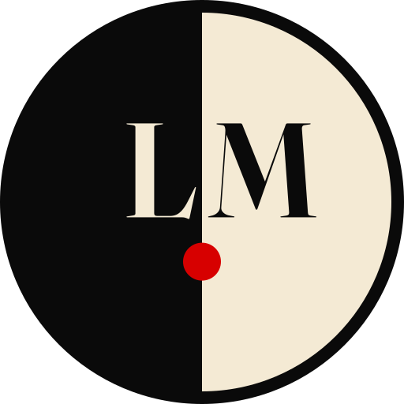

<picture>
  <source media="(prefers-color-scheme: dark)" srcset="https://raw.githubusercontent.com/voaneves/LearningML/master/assets/logo/logo-dark.svg" />
  <source media="(prefers-color-scheme: light)" srcset="https://raw.githubusercontent.com/voaneves/LearningML/master/assets/logo/logo-light.svg" />
  
</picture>

<h1>LearningML</h1>

  <strong>Python and Jupyter examples of regression and neural-network classification on real datasets.</strong> 
  A machine learning study project, with notes in the Feynman technique

  <a href="https://voaneves.github.io/LearningML/"><picture><source media="(prefers-color-scheme: dark)" srcset="https://raw.githubusercontent.com/voaneves/LearningML/master/assets/buttons/landing-dark.svg" /></picture></a>
  <a href="https://github.com/voaneves/LearningML/tree/master/Regression"><picture><source media="(prefers-color-scheme: dark)" srcset="https://raw.githubusercontent.com/voaneves/LearningML/master/assets/buttons/code-dark.svg" /></picture></a>

Need something like this? <a href="https://voaneves.com/en/#contact"><strong>Let's talk →</strong></a>

  
  
  

  <a href="#about-the-project">About</a> ·
  <a href="#whats-inside">What is inside</a> ·
  <a href="#technologies">Technologies</a> ·
  <a href="#contact">Contact</a>

<picture>
  <source media="(prefers-color-scheme: dark)" srcset="https://raw.githubusercontent.com/voaneves/LearningML/master/assets/brand/rule-dark.svg" />
  <source media="(prefers-color-scheme: light)" srcset="https://raw.githubusercontent.com/voaneves/LearningML/master/assets/brand/rule-light.svg" />
  
</picture>

## About the project

Learn how regression and classification work by reading short Python examples run on real datasets, from housing prices to neural networks written by hand.

This is a personal study project: each folder applies a machine learning technique to a dataset, with the code commented step by step. The study notes live in [`LearningML with Feynman's technique.md`](https://github.com/voaneves/LearningML/blob/master/LearningML%20with%20Feynman%27s%20technique.md).

## What is inside

### Regression

- **Boston Housing:** linear regression, elastic net, SVR, random forest, gradient boosting, XGBoost and a stacked model, one script each.
- **Energy consumption:** gradient boosting regression.
- **Gun Violence:** gradient boosting regression.
- **Blue book for Bulldozers:** a Jupyter notebook on a price prediction contest for heavy equipment auctions.

### Classification

- **Sigmoid:** neural networks with sigmoid activation (full batch with one or two synapse layers, mini batch, and the XOR gate with three layers).
- **ReLU + Softmax:** a three-layer ReLU network on the XOR gate, and ReLU with softmax on scikit-learn's `make_moons`.

## Technologies

- **Python** for every example.
- **scikit-learn, pandas and NumPy** for the models and the data.
- **XGBoost, matplotlib and seaborn** for boosting and plots.
- **Jupyter Notebook** for the Bulldozers example.

## Contact

  <a href="https://voaneves.com/en/#contact"><picture><source media="(prefers-color-scheme: dark)" srcset="https://raw.githubusercontent.com/voaneves/LearningML/master/assets/buttons/hire-dark.svg" /></picture></a>
  <a href="https://voaneves.com/en/"><picture><source media="(prefers-color-scheme: dark)" srcset="https://raw.githubusercontent.com/voaneves/LearningML/master/assets/buttons/site-dark.svg" /></picture></a>

<a href="https://linkedin.com/in/voaneves">LinkedIn</a> · <a href="mailto:victorneves478@gmail.com">E-mail</a>

  

Released under the <a href="https://github.com/voaneves/LearningML/blob/master/LICENSE">MIT License</a>.

<a href="#top">↑ Back to top</a>

